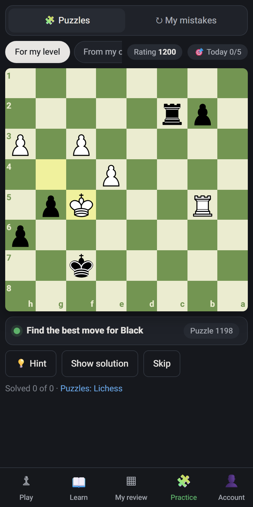

# Chess Trainer

Learn a chess opening repertoire step by step, train it against Stockfish until you know it by heart, solve puzzles at your level, and review your own Chess.com games — in the browser, on your phone, even offline. English, Hebrew and Spanish (a link can choose one: `/?lang=he`).

**Live:** https://opening-trainer-app.vercel.app (also at https://chess-trainer-seven-pink.vercel.app)

<p>
  
  
  
</p>

## Features

- **Learn** — on the first visit choose the openings you play (or let the app recommend three for a beginner). Every line of the repertoire on a board, move by move, with the idea of the line and a one-sentence reason for each of your moves. "Test me" quizzes you on the line; per-line success rate and the move you miss most. Import your own lines from PGN — each is checked against the repertoire and added as a branch. Hide the openings you don’t play (the opening list → ⚙) — nothing is deleted.
- **Play** — train the repertoire against the computer. Leave the line and the game stops, shows the right move and why, and lets you **try again** or **continue**. After the book, a full-strength coach keeps correcting you up to move 15 and remembers the best moves, so the line grows from your own games. Or play a regular game at any level.
- **Repertoire** — 31 openings, 417 lines, almost all of them 11 of your moves deep. **As White** (12 openings, 175 lines): London System, 1.e4 with the Italian (through the Bishop’s Opening) and lines against every other reply, Ruy Lopez, Scotch, King’s Gambit, Vienna, Open Sicilian, English, Colle, Queen’s Gambit, Catalan, Trompowsky. **As Black against 1.e4** (10, 134 lines): 1...e5, Alekhine, Petrov, Scandinavian, French, Pirc, Modern, Caro-Kann, the Sicilian with ...e6, Najdorf. **Against 1.d4** (8, 95 lines): King’s Indian, Nimzo- and Queen’s Indian, Grünfeld, Queen’s Gambit Declined, Benko, Dutch, Slav, Queen’s Gambit Accepted. **Against other first moves** (1, 13 lines): 1.c4 and 1.Nf3. Every user move was checked with Stockfish; where the opening itself costs some win chance (the King’s Gambit, the Scandinavian, the Alekhine…), its note says so.
- **Practice** — about 6,000 puzzles from the Lichess puzzle database with a personal rating, modes *for my level* / *from my openings* (at least 100 from each repertoire, only from the openings you play) / *mates*, a hint counts as half a point, and a daily goal with a streak. **My mistakes** brings back every position you got wrong with spaced repetition (Leitner).
- **My review** — enter a Chess.com username (up to your latest 5,000 games, reloaded automatically next time): the three most useful things to improve, results by color / time control / opening, how you lose, a rating chart, your accuracy month by month (from games reviewed on Chess.com and here), and an optional Stockfish pass over recent games (its big mistakes become drills). It also shows **where your games leave your lines**: add Stockfish's answer to an opponent's unexpected move as a new branch of your repertoire, or practice the spots where you left the line yourself.
- **Game review** — pick any recent game (or "Review my last game") and go through it move by move: every move labeled (book, best, good, inaccuracy, mistake, blunder) with the better move as a green arrow and the engine's line, both players' accuracy, a win-chance graph you can tap, "my next mistake", where the game left your repertoire, and one tap to practice a position. Stockfish runs on your device, so there is no daily limit; a reviewed game opens at once the next time.
- **Installable, offline** — a PWA; after the first visit, learning, training, puzzles and the engine work without internet (the puzzle file is kept a few seconds after the first visit has loaded, so it does not slow it down).
- **Private** — no sign-in needed; anonymous page counts only (Vercel Web Analytics, no cookies). The privacy page is in the account panel and at `/privacy`.
- **Optional Google sign-in** — syncs all progress between devices (Firebase Auth + Firestore). "Delete my cloud data" in the account panel deletes the cloud copy and the sign-in; progress on the device stays.

## Run it

Requires Node.js 24.

```bash
npm install
npm run dev        # http://localhost:5173
```

Production build: `npm run build`, then `npm run preview`.

### Checks

```bash
npm run check   # lint + build + all the checks below
npm test        # just the checks:
                #   scripts/check-i18n.ts     every text of the interface is translated
                #   scripts/check-lines.ts    every repertoire line is legal and fully translated
                #   scripts/check-review.ts   Chess.com review logic and the move-by-move game review
                #   scripts/check-puzzles.ts  every puzzle in public/puzzles-v4.json is legal, and every repertoire has puzzles
                #   scripts/check-sync.ts     merge rules for syncing between devices
```

The same checks run on every push and pull request (GitHub Actions).

### Google sign-in on your own deployment (optional)

Without configuration the app works fully, with progress kept in the browser. To enable sign-in and sync:

1. Create a Firebase project with Google sign-in and Firestore, and publish [`firestore.rules`](firestore.rules) — step by step in [`docs/google-login-setup.md`](docs/google-login-setup.md).
2. Copy [`.env.example`](.env.example) to `.env.local` (and set the same variables in your host).
3. In [`vercel.json`](vercel.json), point the `/__/auth` rewrite at **your** project (`<project-id>.firebaseapp.com`).

## Project structure

| Path | What it is |
|---|---|
| `src/App.tsx` | Tab shell |
| `src/Trainer.tsx` | Training / regular game: book phase, coach, corrections |
| `src/Learn.tsx`, `src/lineStats.ts`, `src/hiddenReps.ts` | Learn page, "test me", per-line stats, hidden openings |
| `src/repertoire.ts` | The opening lines (SAN), ideas and notes |
| `src/nav.ts`, `src/savedGame.ts` | The Back button, and a game that survives a reload |
| `src/Practice.tsx`, `src/Puzzles.tsx`, `src/puzzleData.ts`, `src/daily.ts` | Puzzles, rating, daily goal |
| `src/Drill.tsx`, `src/mistakes.ts` | "My mistakes" spaced repetition |
| `src/Review.tsx`, `src/reviewStats.ts`, `src/chesscom.ts`, `src/analysisCache.ts` | Chess.com review |
| `src/GameReview.tsx`, `src/gameAnalysis.ts` | Reviewing one game move by move |
| `src/Branches.tsx`, `src/deviations.ts`, `src/customLines.ts` | Where games leave the repertoire; branches added from your games |
| `src/engine.ts` | Stockfish Web Worker wrapper, the Lichess win% formula, and what counts as an inaccuracy / mistake / blunder |
| `src/cloud.ts`, `src/firebase.ts`, `src/syncMerge.ts`, `src/Account.tsx` | Optional sign-in and sync |
| `src/i18n.ts`, `src/lang/` | The languages, without a library: `tr('English')` in place, and a dictionary per language. Hebrew: the interface and the opening explanations; Spanish: the interface (the explanations show in English) |
| `index.html`, `scripts/make-og-image.py` | The link preview of social networks (static tags, and `public/og-image.png`, made from the running app) |
| `src/install.ts`, `src/InstallCard.tsx` | Installing the app: when it can be, and the suggestion in Learn and in the account panel |
| `public/engine/` | Stockfish 19 lite (WASM) |
| `public/puzzles-v4.json` | Puzzle set, built by `scripts/build-puzzles.py` (a new set gets a new file name — the service worker caches by name) |
| `public/sw.js` | Offline cache |

The roadmap is in [`PLAN.md`](PLAN.md).

## Contributing

Issues and pull requests are welcome — see [CONTRIBUTING.md](CONTRIBUTING.md). Security reports: [SECURITY.md](SECURITY.md). Please follow the [Code of Conduct](CODE_OF_CONDUCT.md).

## License

Copyright © 2026 Shlomi Nugarker.

Chess Trainer is free software: you can redistribute it and/or modify it under the terms of the **GNU General Public License v3.0 or later** — see [LICENSE](LICENSE). It bundles the Stockfish engine (GPL-3.0) and uses other open-source software and data listed in [THIRD_PARTY_NOTICES.md](THIRD_PARTY_NOTICES.md).

## Credits

[Stockfish](https://stockfishchess.org) and [Stockfish.js](https://github.com/nmrugg/stockfish.js) · [chess.js](https://github.com/jhlywa/chess.js) · [react-chessboard](https://github.com/Clariity/react-chessboard) · puzzles from the [Lichess puzzle database](https://database.lichess.org/#puzzles) (CC0) · game data from the [Chess.com published-data API](https://www.chess.com/news/view/published-data-api).
