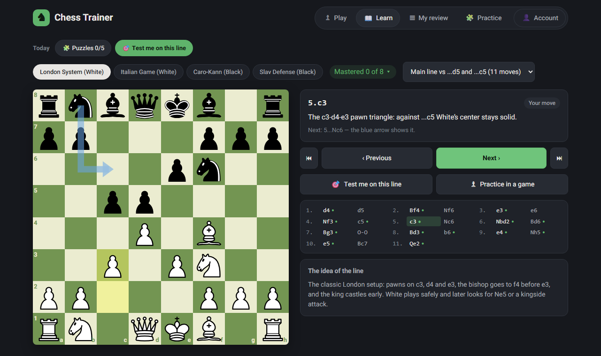
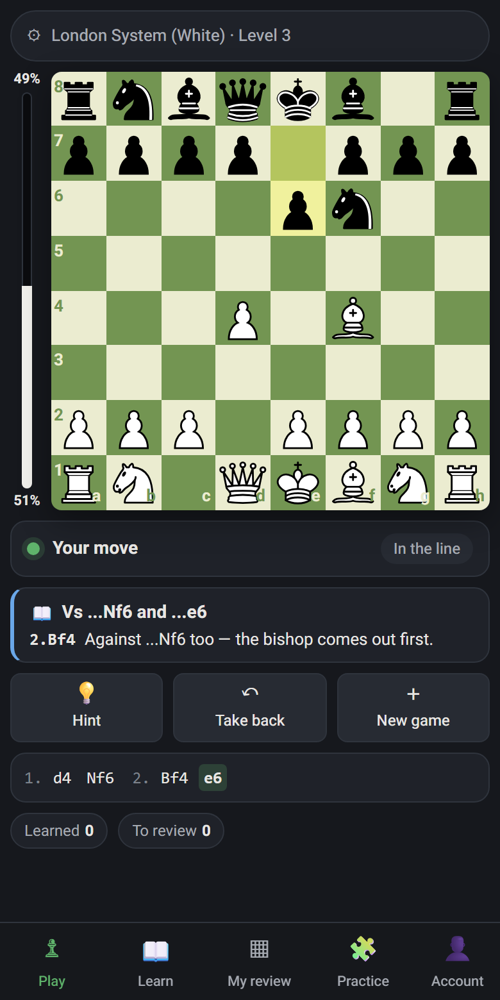

# Chess Trainer

Learn a chess opening repertoire step by step, train it against Stockfish until you know it by heart, solve puzzles at your level, and review your own Chess.com games — in the browser, on your phone, even offline. Hebrew and English.

**Live:** https://chess-trainer-seven-pink.vercel.app

<p>
  
  
  
</p>

## Features

- **Learn** — every line of the repertoire on a board, move by move, with the idea of the line and a one-sentence reason for each of your moves. "Test me" quizzes you on the line; per-line success rate and the move you miss most. Import your own lines from PGN — each is checked against the repertoire and added as a branch.
- **Play** — train the repertoire against the computer. Leave the line and the game stops, shows the right move and why, and lets you **try again** or **continue**. After the book, a full-strength coach keeps correcting you up to move 15 and remembers the best moves, so the line grows from your own games. Or play a regular game at any level.
- **Repertoire** — London System and 1.e4 as White (the Italian Game, plus lines against the Scandinavian, Sicilian (Alapin), French and Caro-Kann (Advance) and the Modern), Caro-Kann (vs 1.e4) and Slav (vs 1.d4) as Black: 38 lines, every user move checked with Stockfish.
- **Practice** — 3,600 puzzles from the Lichess puzzle database with a personal rating, modes *for my level* / *from my openings* / *mates*, and a daily goal with a streak. **My mistakes** brings back every position you got wrong with spaced repetition (Leitner).
- **My review** — enter a Chess.com username: the three most useful things to improve, results by color / time control / opening, how you lose, a rating chart, and an optional Stockfish pass over recent games (its mistakes become drills). It also shows **where your games leave your lines**: add Stockfish's answer to an opponent's unexpected move as a new branch of your repertoire, or practice the spots where you left the line yourself.
- **Installable, offline** — a PWA; learning, training, puzzles and the engine work without internet.
- **Optional Google sign-in** — syncs all progress between devices (Firebase Auth + Firestore).

## Run it

Requires Node.js 22+.

```bash
npm install
npm run dev        # http://localhost:5173
```

Production build: `npm run build`, then `npm run preview`.

### Checks

```bash
npm run lint
npm run build
node --experimental-strip-types scripts/check-lines.ts    # every repertoire line is legal, notes exist in both languages
node --experimental-strip-types scripts/check-review.ts   # Chess.com review logic
node --experimental-strip-types scripts/check-puzzles.ts  # every puzzle in public/puzzles-v1.json is legal
node --experimental-strip-types scripts/check-sync.ts     # merge rules for syncing between devices
```

The same checks run on every push and pull request (GitHub Actions).

### Google sign-in on your own deployment (optional)

Without configuration the app works fully, with progress kept in the browser. To enable sign-in and sync:

1. Create a Firebase project with Google sign-in and Firestore, and publish [`firestore.rules`](firestore.rules) — step by step in [`docs/google-login-setup.md`](docs/google-login-setup.md).
2. Copy [`.env.example`](.env.example) to `.env.local` (and set the same variables in your host).
3. In [`vercel.json`](vercel.json), point the `/__/auth` rewrite at **your** project (`<project-id>.firebaseapp.com`).

## Project structure

| Path | What it is |
|---|---|
| `src/App.tsx` | Tab shell |
| `src/Trainer.tsx` | Training / regular game: book phase, coach, corrections |
| `src/Learn.tsx`, `src/lineStats.ts` | Learn page, "test me", per-line stats |
| `src/repertoire.ts`, `src/repertoire.en.ts` | The opening lines (SAN), ideas and notes — Hebrew and English |
| `src/Practice.tsx`, `src/Puzzles.tsx`, `src/puzzleData.ts`, `src/daily.ts` | Puzzles, rating, daily goal |
| `src/Drill.tsx`, `src/mistakes.ts` | "My mistakes" spaced repetition |
| `src/Review.tsx`, `src/reviewStats.ts`, `src/chesscom.ts`, `src/analysisCache.ts` | Chess.com review |
| `src/Branches.tsx`, `src/deviations.ts`, `src/customLines.ts` | Where games leave the repertoire; branches added from your games |
| `src/engine.ts` | Stockfish Web Worker wrapper and the Lichess win% formula |
| `src/cloud.ts`, `src/firebase.ts`, `src/syncMerge.ts`, `src/Account.tsx` | Optional sign-in and sync |
| `src/i18n.ts` | Two languages without a library: `tr('עברית', 'English')` |
| `public/engine/` | Stockfish 19 lite (WASM) |
| `public/puzzles-v1.json` | Puzzle set, built by `scripts/build-puzzles.py` |
| `public/sw.js` | Offline cache |

The roadmap is in [`PLAN.md`](PLAN.md) (Hebrew).

## Contributing

Issues and pull requests are welcome — see [CONTRIBUTING.md](CONTRIBUTING.md). Security reports: [SECURITY.md](SECURITY.md). Please follow the [Code of Conduct](CODE_OF_CONDUCT.md).

## License

Copyright © 2026 Shlomi Nugarker.

Chess Trainer is free software: you can redistribute it and/or modify it under the terms of the **GNU General Public License v3.0 or later** — see [LICENSE](LICENSE). It bundles the Stockfish engine (GPL-3.0) and uses other open-source software and data listed in [THIRD_PARTY_NOTICES.md](THIRD_PARTY_NOTICES.md).

## Credits

[Stockfish](https://stockfishchess.org) and [Stockfish.js](https://github.com/nmrugg/stockfish.js) · [chess.js](https://github.com/jhlywa/chess.js) · [react-chessboard](https://github.com/Clariity/react-chessboard) · puzzles from the [Lichess puzzle database](https://database.lichess.org/#puzzles) (CC0) · game data from the [Chess.com published-data API](https://www.chess.com/news/view/published-data-api).
